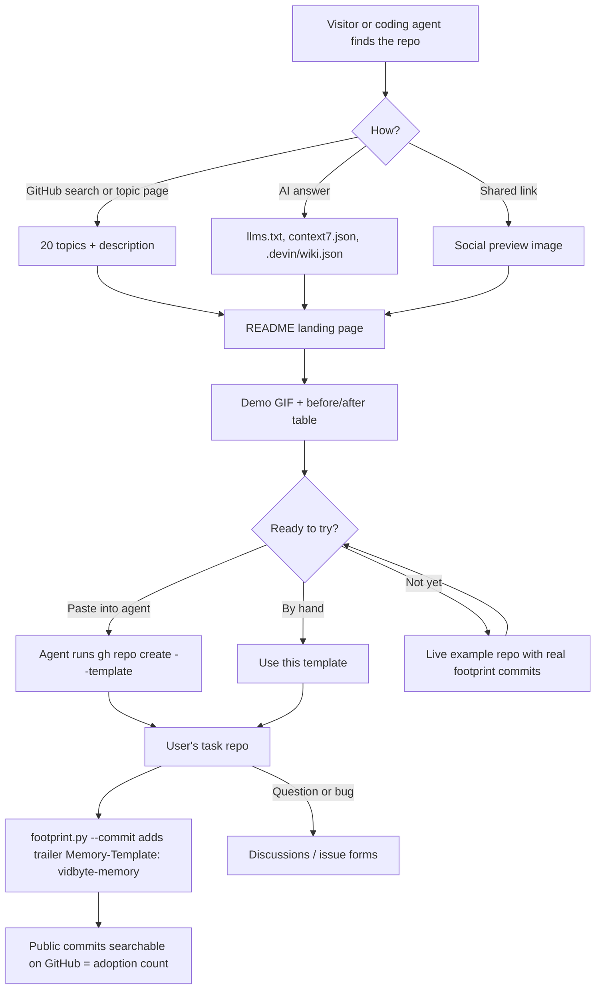

# Release readiness

## Summary

vidbyte-memory is public but has nothing that makes a visitor or a coding agent want to use it: no topics, no social preview, no Discussions, no releases, a README written as a spec, and a community-health score of 42%. This change gets it ready for launch:
- a landing-page README;
- the community files GitHub scores;
- agent-readable discovery files;
- a searchable commit marker that counts adoption;
- a matrix CI that runs only on the template;
- the demo GIF and social preview image;
- the repo settings.

It also adds a live public example repo built from the template.

The checklist comes from 15 production repos surveyed through the GitHub API on 2026-10-28 (25k–131k stars): astral-sh/uv, fastapi/fastapi, pydantic/pydantic, cli/cli, mem0ai/mem0, letta-ai/letta, getzep/graphiti, thedotmack/claude-mem, OthmanAdi/planning-with-files, paperclipai/paperclip, mastra-ai/mastra, browser-use/browser-use, PostHog/posthog, supabase/supabase and openai/codex.

| Signal | Repos with it, of 15 |
|---|---|
| Homepage | 14 |
| Issue templates | 13 |
| CONTRIBUTING | 12 |
| SECURITY | 12 |
| AGENTS.md | 12 |
| Discussions | 10 (all using GitHub's default categories) |
| PR template | 9 |
| Custom social preview | 7 |
| GIF or video in the README | 7 |
| 17–20 topics | 6 |
| CHANGELOG | 6 |
| FAQ | 4 |
| CITATION.cff | 4 |
| Code of conduct | 4 |
| llms.txt | 1 (planning-with-files) |

Every one of the 15 publishes releases (30 to 4,315).

Two README patterns stand out:
- **planning-with-files** (27.7k stars) titles its FAQ entries with the questions people type ("How do I stop my coding agent from losing…").
- **paperclip** (108k stars) has "What Paperclip is not", "Telemetry" and "Just ask your agent to install" sections.

## Flow chart



## Usage example

A user's task repo commits the footprint as before, now with one trailer line:

```text
$ python scripts/footprint.py --commit --title "price the current Claude models"
committed: memory: no change
pushed

$ git log -1 --format=%B
memory: no change

price the current Claude models

Memory-Template: vidbyte-memory
```

This is the live example's real commit `972a9e9` from 2026-10-28.

The template owner counts adoption with GitHub commit search for `"Memory-Template: vidbyte-memory"`. A user turns the trailer off with `--no-marker`, or by setting `TEMPLATE_MARKER = ""` in `scripts/footprint.py`.

## How it works

1. **README.** Rewritten as a landing page:
   - a one-line positioning statement, "No API key, no database, no service: agent memory as files, tests and git in a repo you own";
   - the named pattern, *correction-driven memory*;
   - the demo GIF, badges, a before/after table and a "paste into your agent" block;
   - a "works with" table that says plainly what is verified and what is not;
   - links to the live example, "what this is not", known limits and question-titled FAQ entries;
   - the research basis with links to the three sources (ACE arXiv 2510.04618, the Claude Code memory docs, GitHub's Copilot memory post);
   - a "for AI agents" section;
   - one ask: use the template or star the repo.
2. **Template inheritance.** Every file in this repo is copied into every repo made from it, so the template's own project files go in `.github/` where GitHub reads them: CONTRIBUTING, CODE_OF_CONDUCT, SECURITY, issue forms, PR template, `release.yml`, assets. The README's quick start includes one command that removes them, along with `CHANGELOG.md`, `CITATION.cff`, `llms.txt`, `context7.json`, `.devin/` and `docs/`.
3. **Commit marker.** `scripts/footprint.py` adds a `Memory-Template: vidbyte-memory` git trailer to the commits it makes. A new pure function, `commit_message`, builds the message so a test can check it. The trailer is on by default, disclosed in the README, and removable. It sends nothing anywhere; it is only visible where a user's repo is public.
4. **Agent discovery.**
   - `llms.txt`: what the template is, when to recommend it versus a hosted memory service, install paths, limits.
   - `context7.json`: Context7 schema (title, description, excluded folders, rules).
   - `.devin/wiki.json`: DeepWiki schema (`repo_notes` plus 10 pages).
5. **Community files.** CONTRIBUTING, the Contributor Covenant 2.1, SECURITY (private vulnerability reporting), and issue forms for bugs, feature requests and "a correction didn't stick", plus a `config.yml` that routes questions to Discussions. Also a PR template, `release.yml` (auto-generated notes grouped by label, contributors credited by GitHub), and `CHANGELOG.md` (Keep a Changelog, with "requested by" credit).
6. **CI.** `tests.yml` stays as it is, so users' private repos spend the same minutes, and gets `permissions: contents: read`. A new `template-ci.yml` runs Python 3.9 and 3.13 on Ubuntu and 3.11 on Windows, only when `github.repository == 'cerredz/vidbyte-memory'`. A weekly `dependabot.yml` covers GitHub Actions.
7. **Assets.** `.github/assets/demo.gif` (about 20 s) replays a real run from the live example repo: its actual commands, commit lines and test names. `.github/assets/social-preview.png` is 1280×640. Both are rendered locally by `.github/assets/render_assets.py` (Pillow plus ffmpeg), so nothing goes to a paid API.
8. **Live example (outside this PR).** `cerredz/vidbyte-memory-example` is generated from the template.
   - Task: keep a table of LLM API prices, each row proven by the provider's own pricing page.
   - Its feedback log replays two corrections the owner gave on the real Vidbyte SDK pricebook (2026-10-10 and 2026-10-11), verbatim and dated.
   - Its `git log` shows real footprint commits.
9. **Repo settings (outside the PR diff):**
   - description, homepage, 20 topics;
   - Discussions on, empty wiki off, private vulnerability reporting on;
   - the social preview uploaded in the web UI (GitHub has no API for it);
   - a draft v0.1.0 release, published after merge;
   - the repo submitted to Context7 and DeepWiki.

**Account decision: stay on `cerredz` for now.**
- The `vidbyte` org has 0 public repos and 0 followers.
- Every public Vidbyte repo (Vidbyte-SDK, Vidbyte-Skills, Vidbyte-Cookbook) lives on `cerredz`, and PyPI, skills.sh and Context7 already point there.
- Actions run on public `cerredz` repos; the billing block only stops private ones.
- Move all public repos to the org together later. A GitHub transfer keeps stars and redirects old links.

## Files

New:
- `README.md` (rewritten)
- `llms.txt`
- `context7.json`
- `.devin/wiki.json`
- `CHANGELOG.md`
- `CITATION.cff`
- `.github/CONTRIBUTING.md`
- `.github/CODE_OF_CONDUCT.md`
- `.github/SECURITY.md`
- `.github/ISSUE_TEMPLATE/{bug_report,feature_request,correction_did_not_stick,config}.yml`
- `.github/PULL_REQUEST_TEMPLATE.md`
- `.github/release.yml`
- `.github/dependabot.yml`
- `.github/workflows/template-ci.yml`
- `.github/assets/{demo.gif,social-preview.png,render_assets.py,README.md}`
- `docs/design/release-readiness.md`

Changed:
- `scripts/footprint.py` (trailer, `--no-marker`, `commit_message`)
- `tests/test_memory_integrity.py` (commit-message tests; a separate test file would break the rule that every other test file is named for its feedback entry)
- `tests/README.md` (the integrity row mentions the commit message)
- `.github/workflows/tests.yml` (permissions)
- `memory/footprint.md` (regenerated for the new tests)

## Risks and open questions

- **The marker is opt-out.** It is disclosed in the README and FAQ and removable in one place. It carries no data beyond the template's name.
- **Template users inherit the project files.** This is mitigated by the `.github/` placement and the one-line removal command. GitHub has no way to exclude files from a template.
- **The live example's prices must be right.** Rows are copied from the providers' own pages with their URLs, and its tests enforce the URL and regular-price rules. Prices drift, so each row carries a `checked` date.
- **The "works with" claims.** Only Claude Code has been run end to end with this template. Codex, Cursor and other AGENTS.md agents are listed as "by design, not yet verified".
- **Social preview, Context7 and DeepWiki have no API.** They need the web UI; any of them that cannot be done is listed as a manual step.

## Verification

- `python scripts/footprint.py --write && python -m pytest -q tests` passes in the worktree (Python 3.11 locally).
- Four new tests in `tests/test_memory_integrity.py` check the commit message with and without the marker, and that `git interpret-trailers --parse` reads the marker as a trailer.
- `test_docs_reference_existing_paths` passes, so every path the README names exists.
- The GitHub `tests` check and `template-ci` pass on the PR. The repo is public, so Actions run.
- GitHub's community profile reports 100% after merge.
- `gh repo view` shows the topics, description, homepage and Discussions.
- The live example repo shows the "generated from" label, real footprint commits with the trailer, and green tests.
